# THE BILLIONAIRE WEALTH INVESTIGATION

## Introduction
Global ultra high net worth wealth is heavily concentrated across specific countries, industries, and age demographics. Acting as a Junior Data Analyst for a global financial research organization, this project uses SQLite to examine the financial standings and demographics of the world’s 200 richest individuals. The goal is to uncover clear patterns in wealth distribution, sector dominance, and generational shifts among top global billionaires

## About the Dataset
The dataset contains 200 records and 7 columns capturing the world's richest individuals according to Forbes. Each row represents a single billionaire or billionaire family, providing geographic, demographic, and financial attributes.
- serial_number. Sequential numbering of the billionaires from 1 to 200.
- world_rank. The official global ranking based on net worth.
- name. The full name of the billionaire or family.
- age. The age of the individual in years.
- country. The primary country of citizenship or residence.
- net_worth. Total estimated net worth measured in billions of US dollars ($B).
- industry. The primary economic sector generating the individual's wealth

 ## Problem Statement
 Financial researchers need data driven answers to understand where extreme wealth is created and how it is distributed globally. Without structured querying, raw rankings obscure key trends such as geographic monopolies, age disparities across sectors, and top heavy wealth skew. This investigation addresses 10 core business questions alongside 5 custom deep-dive queries to evaluate wealth share, age brackets, and sector comparisons

## SQL Code & Results
**Numbers of column**
- SELECT COUNT(*) AS total_columns
- FROM pragma_table_info('billionaires');
  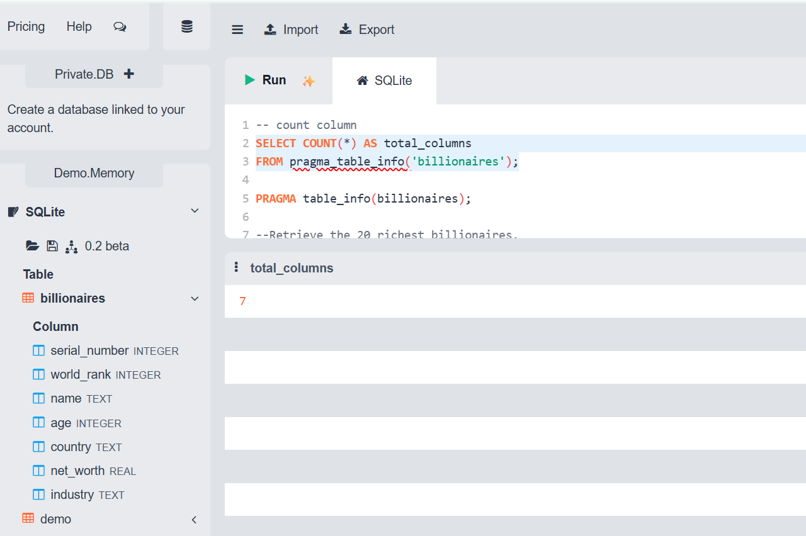
  
  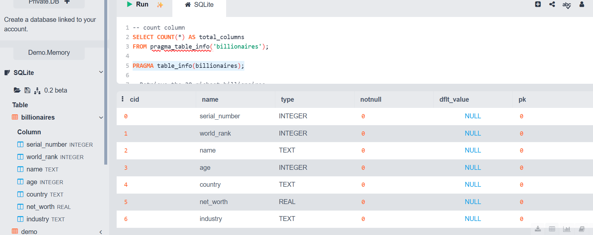

  **Numbers of rows**
 - SELECT COUNT(*) AS total_rows
 - FROM billionaires;
   

   ## 1. Retrieve the 20 richest billionaires
- SELECT name, world_rank, net_worth, country, industry
- FROM billionaires
- ORDER BY net_worth DESC
- LIMIT 20;
  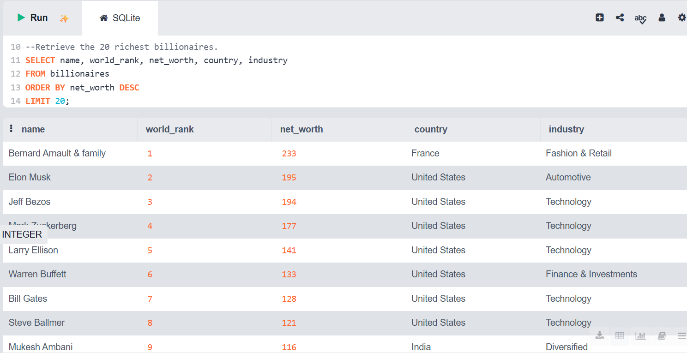

## 2. Identify the five youngest billionaires
SELECT name, age, net_worth, country, industry
FROM billionaires
ORDER BY age ASC
LIMIT 5;

## 3. Calculate the average age and average net worth
- SELECT 
  -  ROUND(AVG(age), 2) AS average_age,
  -  ROUND(AVG(net_worth), 2) AS average_net_worth
- FROM billionaires;
  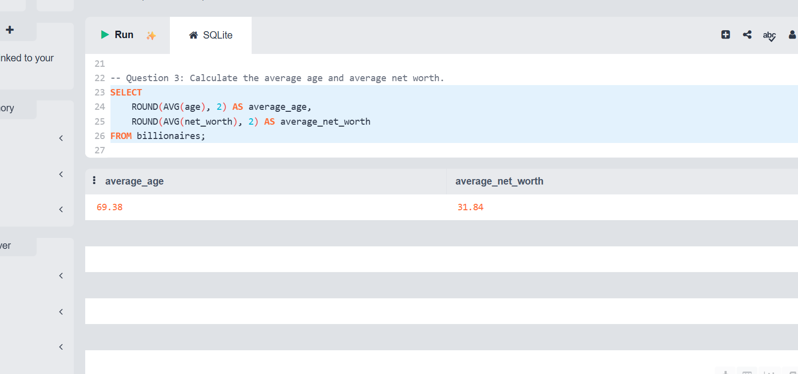

## 4. Identify the five most represented countries
-SELECT country, COUNT(*) AS billionaire_count
- FROM billionaires
- GROUP BY country
- ORDER BY billionaire_count DESC
- LIMIT 5;
  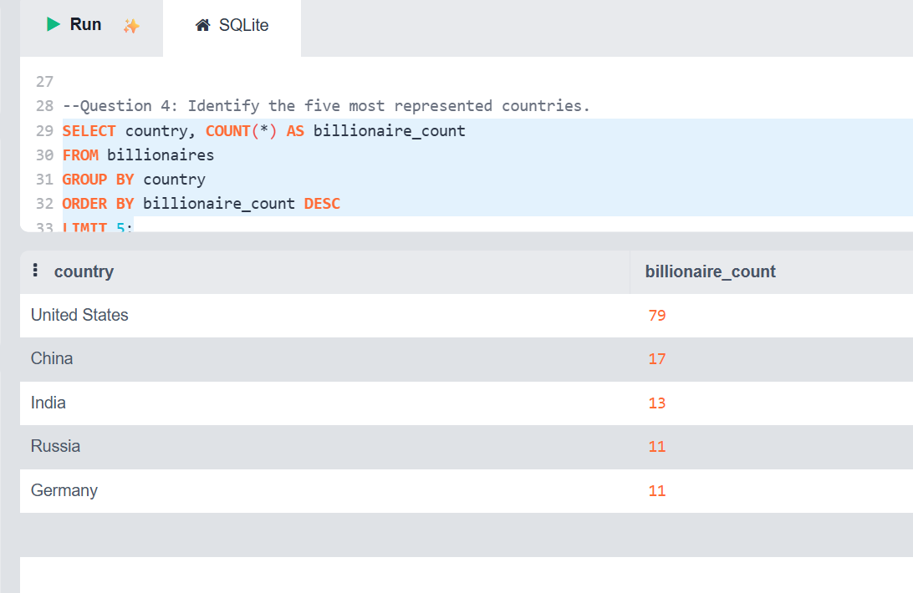

 ## 5. Calculate the combined net worth of billionaires from each country
- SELECT country, ROUND(SUM(net_worth), 2) AS total_net_worth
- FROM billionaires
- GROUP BY country
- ORDER BY total_net_worth DESC;
  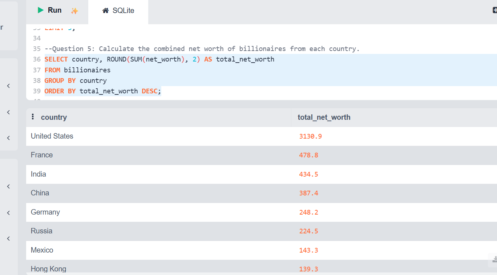

## 6. Identify the five industries with the highest number of billionaires
- SELECT industry, COUNT(*) AS billionaire_count
- FROM billionaires
- GROUP BY industry
- ORDER BY billionaire_count DESC
- LIMIT 5;
  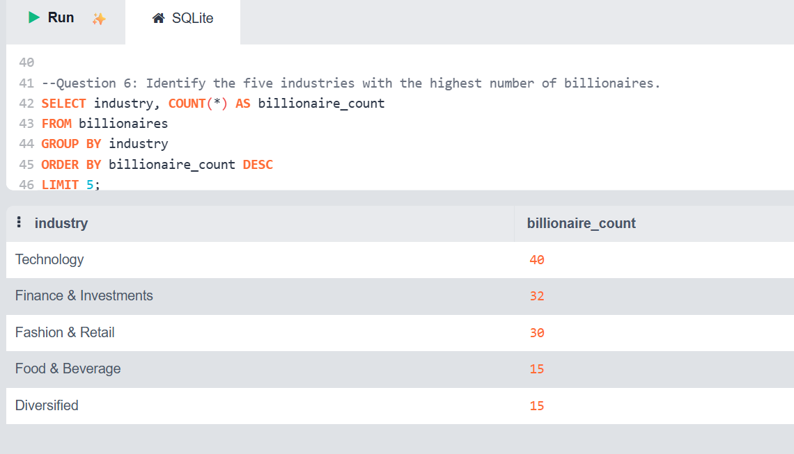

## 7. Find countries with at least five billionaires
- SELECT country, COUNT(*) AS billionaire_count
- FROM billionaires
- GROUP BY country
- HAVING COUNT(*) >= 5
- ORDER BY billionaire_count DESC;
  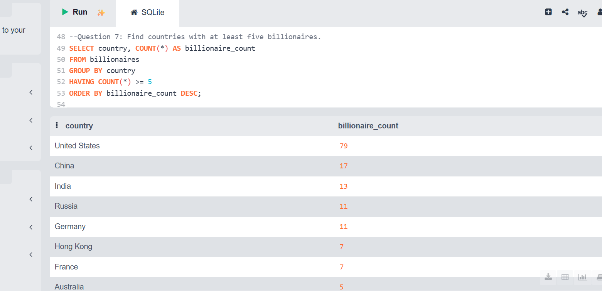

## 8. Calculate the total wealth of billionaires younger than 50
- SELECT ROUND(SUM(net_worth), 2) AS total_wealth_under_50
- FROM billionaires
- WHERE age < 50;
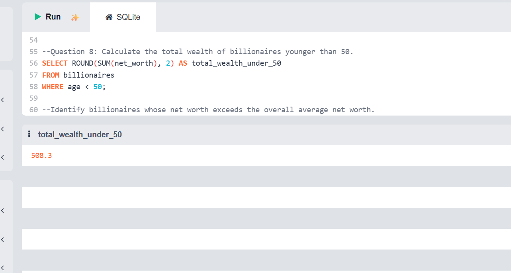

## 9. Identify billionaires whose net worth exceeds the overall average net worth
- SELECT name, net_worth, country, industry
- FROM billionaires
- WHERE net_worth > (SELECT AVG(net_worth) FROM billionaires)
- ORDER BY net_worth DESC;
  

## 10. Identify the industry with the highest average net worth
- SELECT industry, ROUND(AVG(net_worth), 2) AS average_net_worth
- FROM billionaires
- GROUP BY industry
- ORDER BY average_net_worth DESC
- LIMIT 1;
  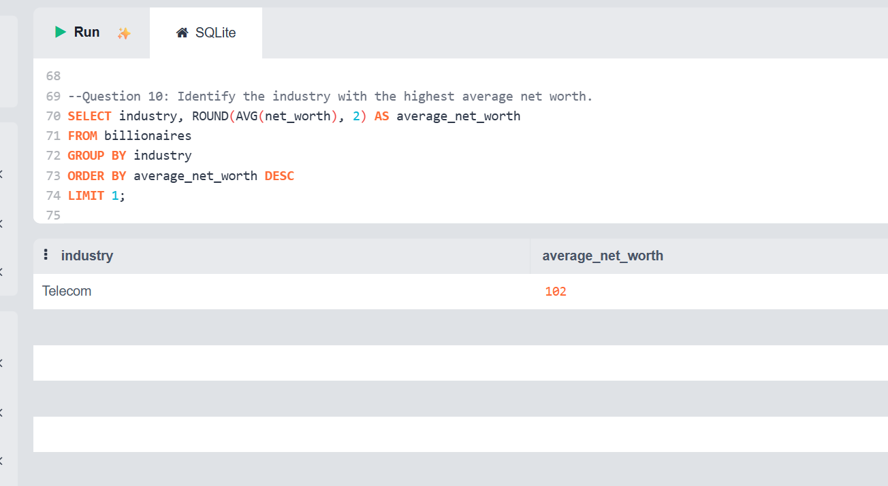

## 11. Wealth distribution across age brackets
- SELECT 
  -  CASE 
   -     WHEN age < 50 THEN 'Under 50'
     -   WHEN age BETWEEN 50 AND 69 THEN '50 to 69'
      -  WHEN age BETWEEN 70 AND 89 THEN '70 to 89'
       - ELSE '90 and above'
   - END AS age_group,
   - COUNT(*) AS billionaire_count,
   - ROUND(SUM(net_worth), 2) AS total_wealth,
   - ROUND(AVG(net_worth), 2) AS average_wealth
- FROM billionaires
- GROUP BY age_group
- ORDER BY total_wealth DESC;
  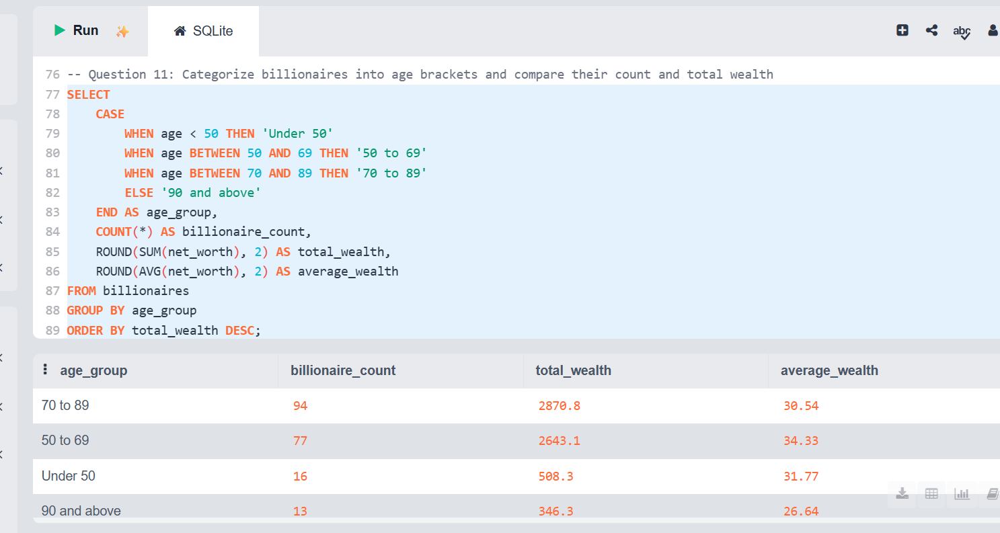

## 12. Top 5 industries by share of global billionaire wealth
- SELECT 
  -  industry,
   - COUNT(*) AS billionaire_count,
   - ROUND(SUM(net_worth), 2) AS total_wealth,
   - ROUND(SUM(net_worth) * 100.0 / (SELECT SUM(net_worth) FROM billionaires), 2) AS wealth_share_pct
- FROM billionaires
- GROUP BY industry
- ORDER BY wealth_share_pct DESC;
  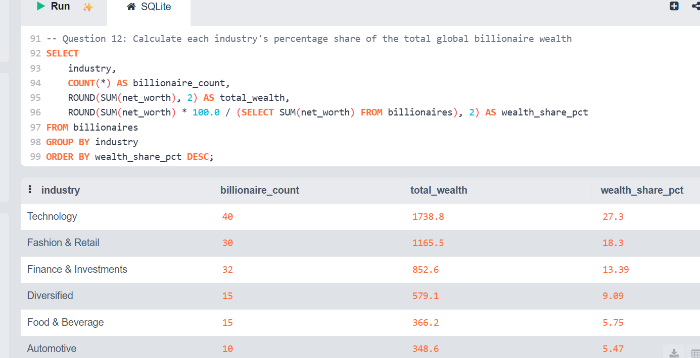

  13. Single richest billionaire in each industry (Top 5)
-vSELECT 
   - industry,
   - name AS richest_billionaire,
   - country,
   - MAX(net_worth) AS highest_net_worth
- FROM billionaires
- GROUP BY industry
- ORDER BY highest_net_worth DESC;
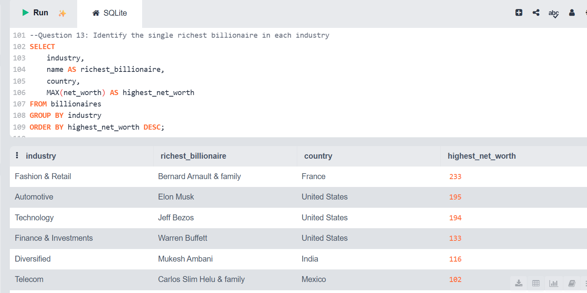

## 14. Countries with average net worth above $30B (minimum 2 billionaires)
- SELECT 
   - country,
   - COUNT(*) AS billionaire_count,
   - ROUND(AVG(net_worth), 2) AS average_net_worth
- FROM billionaires
- GROUP BY country
- HAVING COUNT(*) >= 2 AND AVG(net_worth) > 30
- ORDER BY average_net_worth DESC;
  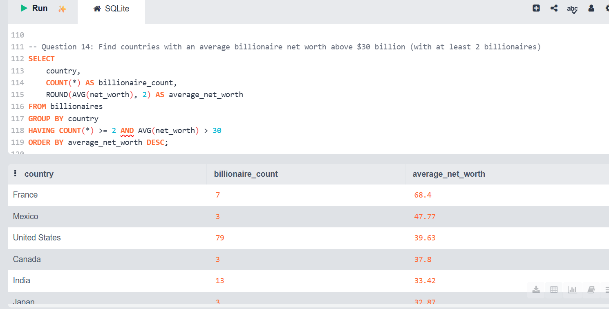

## 15. Technology vs. Fashion & Retail comparison
- SELECT 
   - industry,
   - COUNT(*) AS billionaire_count,
   - ROUND(AVG(age), 1) AS average_age,
   - ROUND(AVG(net_worth), 2) AS average_net_worth,
   - ROUND(SUM(net_worth), 2) AS total_net_worth
- FROM billionaires
- WHERE industry IN ('Technology', 'Fashion & Retail')
- GROUP BY industry;
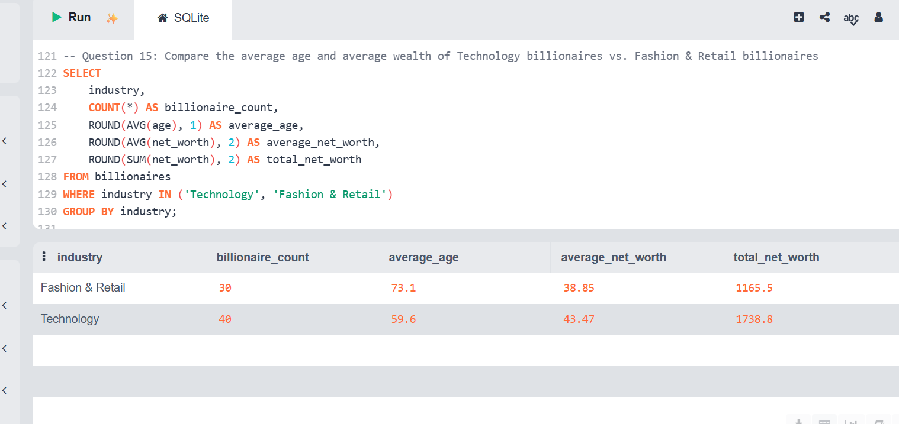

## Key Insights

- Extreme U.S. Dominance. The United States accounts for 39.5% (79 of 200) of the world's richest people and 49.16% ($3,130.9B of $6,368.5B) of their combined net worth.
- Top-Heavy Wealth Skew. Only 53 billionaires (26.5%) have a net worth above the dataset mean of $31.84B. Mega-fortunes at the very top pull the average far above the median.
- Generational Divide by Sector. Technology billionaires are 13.5 years younger on average (59.6 years) than Fashion & Retail billionaires (73.1 years), yet they command higher average wealth ($43.47B vs. $38.85B).
- Youth Wealth Concentrates in Tech. Among the 16 billionaires under age 50, 10 built their fortunes in Technology, led by Mark Zuckerberg ($177.0B).
- High Wealth Density in France. While France ranks 6th in headcount with just 7 billionaires, it ranks 2nd in total wealth ($478.8B) and 1st in average wealth among multi-billionaire nations ($68.40B) due to luxury retail giants.

 ## Recommendations

- Target High-Growth Tech Markets for Institutional Research. Financial research teams should prioritize Technology and AI-adjacent sectors, which generate nearly one-third (27.30%) of top-tier wealth at a faster, younger lifecycle.
- Use Median Metrics Alongside Averages in Executive Reporting. Because the top 20 billionaires heavily skew the $31.84B mean, future reports should include median net worth and interquartile ranges to avoid distorted benchmarks.
- Monitor Generational Wealth Transfers. With 107 billionaires aged 70 or older holding $3,217.1B (50.5% of total wealth), wealth management firms should prepare for massive succession and philanthropic shifts over the next decade.

## Conclusion

This SQL investigation demonstrates how structured querying transforms raw demographic tables into strategic financial intelligence. By combining aggregations, conditional grouping (CASE), subqueries, and filtering (HAVING), the analysis confirms that modern global wealth is anchored in U.S. Technology and European Luxury Retail, while highlighting an imminent generational transition among aging legacy fortunes.
